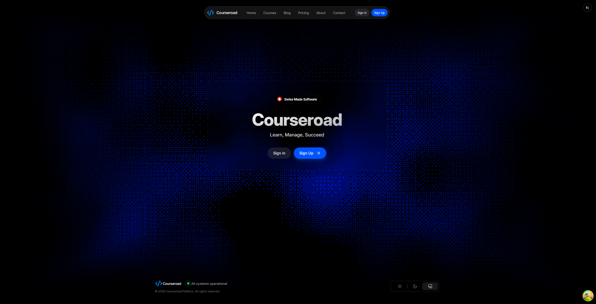
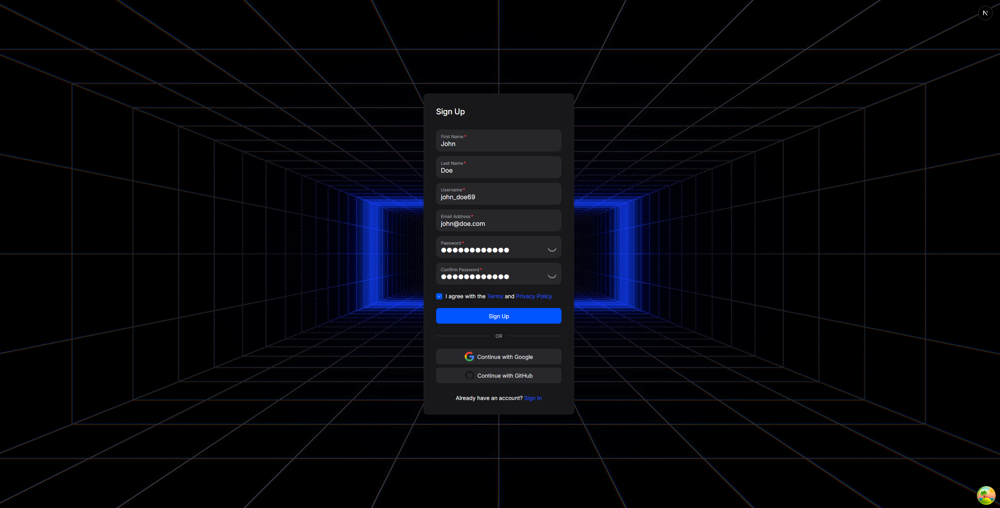

# Courseroad

## Deployment

https://courseroad-staging.vercel.app/

## Stack

next.js and react.

## How to run

1. Clone the source code to your device

```sh
git clone https://github.com/n1ne1ota/courseroad.git
```

2. Install the project's dependencies

```sh
npm install
```

3. Start the development server on `localhost:4321`

```sh
npm run dev
```

4. Build the site to `/dist`

```sh
npm run build
```

and also some stuff and keys in .env file

## AI DISCLOSURE

mostly debugging, bug fixing, and the complex vertex shader on the landing page

## Landing Page



## Auth Page


