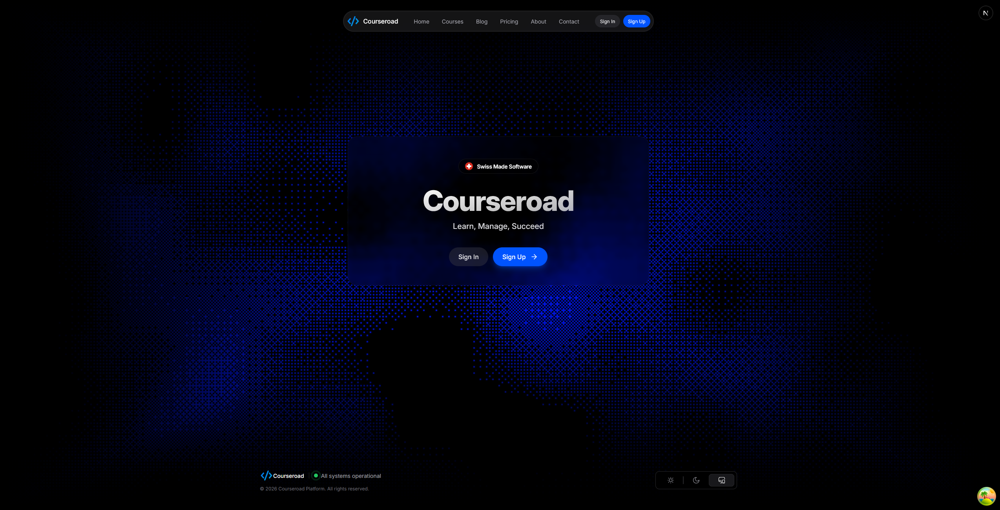
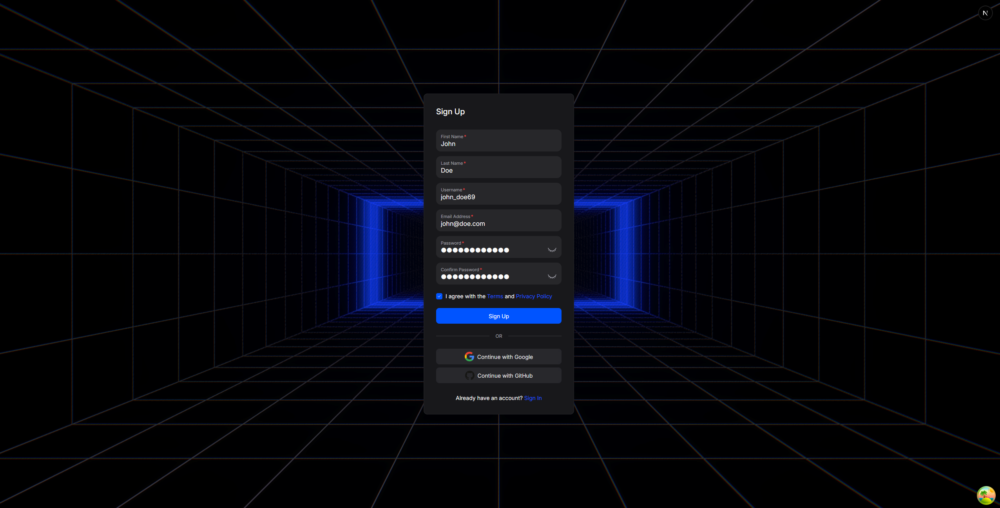

# Courseroad

https://courseroad-staging.vercel.app/

hey! this is text explaining what my awesome project is :)
here's an AWESOME gif of my project!


## HOW THIS WAS MADE

this project was made with next.js and react.

## heres how to run the project :)

1. Clone the source code to your device

```sh
git clone https://github.com/n1ne1ota/courseroad.git
```

2. Install the project's dependencies

```sh
npm install
```

3. Start the development server on `localhost:4321`

```sh
npm run dev
```

4. Build the site to `/dist`

```sh
npm run build
```

and also some stuff and keys in .env file

and be joyous!

## AI DISCLOSURE

what did you use ai for on this project? for example for this site:
ai was used to copy css styling from template screenshots

mostly debugging, bug fixing, and the complex vertex shader on the landing page

## Landing Page



## Auth Page


