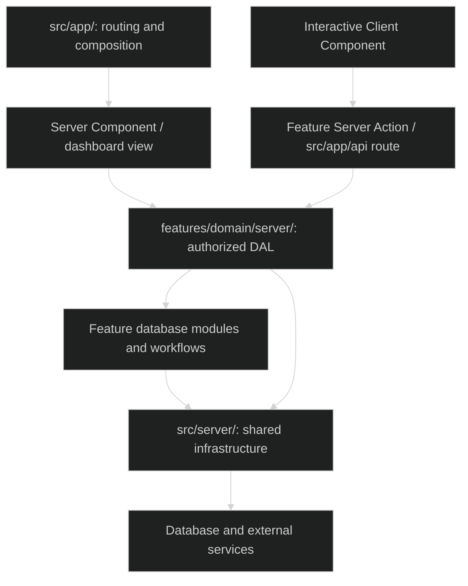

# Courseroad Feature Architecture: Agent Workflow

This guide is the operational workflow for creating, modifying, or improving features in `apps/web`. For canonical rules
and placement tables, see:

- [Feature Architecture](./01_FEATURE_ARCHITECTURE.md): Folder vocabulary, scaling thresholds, and sibling import rules.
- [Client State and Fetching](./02_CLIENT_STATE_FETCHING.md): SSR-safe stores, URL state, and query hydration.
- [Server Data Access](./03_SERVER_DATA_ACCESS.md): Independent DAL authorization, projections, caching, and transport.

## Start Here

1. Read [AGENTS.md](../../../../../AGENTS.md) and [SPEC_INDEX.md](../../../../../docs/SPEC_INDEX.md). Open the task
   linked by the request and verify its scope against current code; folder names alone do not establish active work.
2. Check `.agents/skills/` for a matching skill and apply
   [Documentation Conventions](../../../../../docs/project/07_CONVENTIONS.md) over generic templates. Preserve existing
   task IDs and discover both hyphenated and underscored spec filenames.
3. Inspect the working tree before editing. Preserve unrelated changes, intentional deletions, URLs, and existing
   behavior outside the requested scope.
4. Trace an existing operation in the target domain end-to-end: route, view/component, action or HTTP handler,
   authorized `server/` DAL, and persistence module. Read its tests and callers first.
5. Select the matching workflow below and register or update a task spec when tracked work requires it.

| Request                         | Workflow                                | Evidence to establish first                                       |
| ------------------------------- | --------------------------------------- | ----------------------------------------------------------------- |
| Add a new capability or domain  | [Create a Feature](#create-a-feature)   | User behavior, domain owner, entry points, permissions            |
| Change existing behavior        | [Modify a Feature](#modify-a-feature)   | Current behavior, affected callers, intended result               |
| Refactor, simplify, or optimize | [Improve a Feature](#improve-a-feature) | Concrete problem, preserved behavior, verification or measurement |

## Architecture Guardrails



- **Ownership & composition:** `src/app/` routes and `features/dashboard/` compose product features; sibling features
  cannot import each other's internals except media's four documented exports (`image-upload`, `video-upload`,
  `video-player`, `video-status`), enforced by [apps/web/eslint.config.mjs](../../../eslint.config.mjs).
- **Client/server boundaries:** Keep `use client` on the smallest interactive leaves. Keep `import 'server-only';` on
  executable server modules (maintenance scripts use `src/server/db/connection.ts`, `src/server/config/runtime.ts`, and
  `src/server/logging/runtime.ts`). Keep browser-safe contracts in `schemas/` and `types/`, never inside `server/`.
- **Independent authorization:** Validate all inputs, resolve the caller inside `server/` DALs, verify membership/role
  and parent ownership independently of layouts, and derive org context from the URL slug via `getOrganizationContext`
  rather than `session.activeOrganizationId`.

### Transport Selection

| Caller                                                                      | Transport                          | Error handling                                                                            |
| --------------------------------------------------------------------------- | ---------------------------------- | ----------------------------------------------------------------------------------------- |
| Server Component reading data                                               | Direct ordinary DAL call           | Page adapters (`readForPage`) map access errors to redirects or `notFound`                |
| Browser mutating data or performing uncached imperative reads               | Thin feature Server Action         | Preserve validation/action envelopes; rethrow navigation signals through existing helpers |
| Browser polling, HTTP-cached, or URL-addressable private reads              | Authenticated, validated `GET` API | Return status codes, JSON-safe DTOs, and `Cache-Control: private, no-store`               |
| Better Auth, uploads, playback, payment integrations, webhooks, unsubscribe | Existing HTTP boundary             | Preserve URL, signature checks, status codes, and retry semantics                         |

### Existing Examples to Read

- [Learner dashboard route](<../../app/(dashboard)/organization/[slug]/learner/dashboard/page.tsx>) ->
  [dashboard presentation](../dashboard/organization/learner/dashboard/dashboard-page.tsx) ->
  [course loader](../course/server/loaders/organization-learner-dashboard.ts).
- [Course access](../course/server/access.ts): independent enrollment, ownership, org scope, and lesson checks.
- [Quiz submission action](../quiz/actions/quiz-submission-actions.ts) ->
  [server workflow](../quiz/server/workflows/quiz-submission-actions.ts): validation, grading, persistence,
  invalidation.
- [Private GET helper](../../server/http/private-read.ts): HTTP error mapping and private cache headers.

## Create a Feature

1. Confirm the capability does not belong in an existing feature directory.
2. Define routes, callers, permissions, projections (public/learner/editor/admin), and integration boundaries.
3. Start flat, adding `server/` for any private server work; add `schemas/`, `types/`, `actions/`, `components/`,
   `lib/`, `hooks/`, or `store/` only when file count (~8–10) or clear boundaries warrant them (no empty scaffold slots
   or barrel exports).
4. Implement browser-safe `schemas/` and `types/` plus the authorized `server/` DAL and resource checks before wiring
   UI.
5. Add thin `actions/` or `app/api/**/route.ts` adapters per the transport table, keeping `prismaClient` and server
   `env` inside `server/`.
6. Compose in `app/` or `features/dashboard/` (route-only UI goes in route `_components/`, shared app UI in
   `src/components/`).
7. Add tests covering allowed behavior, denied callers, foreign tenants/parents, and sensitive-field omissions, then run
   [verification](#verification-and-completion).

```text
features/<domain>/
├── <domain>-form.tsx       # interactive UI if small
├── schemas.ts             # or schemas/ when split
├── types.ts               # or types/ for browser-safe DTOs
├── actions.ts             # or actions/ for thin Server Action adapters
└── server/
    └── <operation>.ts     # authorized domain operation (import 'server-only')
```

## Modify a Feature

1. Trace all callers of the changing behavior: routes, dashboard compositions, actions, API routes, tests, and scripts.
2. Compare current vs. desired contracts (schemas, DTOs, permission rules, status codes, action envelopes) and preserve
   unaffected contracts.
3. Update policy and persistence inside the owning feature's `server/` code—never bypass the DAL with a second query in
   a route or page.
4. Verify parent/child associations and organization membership server-side on every resource selector.
5. Preserve transactions, server-side grading, webhook idempotency, and route/tag invalidation using verified slugs.
6. Update/add unit and denial-path tests, refresh docs if boundaries changed, and run
   [verification](#verification-and-completion).

## Improve a Feature

1. Identify the concrete problem (duplicated policy, boundary violation, broad `'use client'`, over-fetching) and the
   observable behavior to preserve.
2. Keep refactors inside the owning domain unless moving truly domain-agnostic UI to `src/components/` or shared
   infrastructure to `src/server/` or `src/lib/`.
3. Update imports, mocks, tests, and docs together when moving files; remove obsolete forwarding modules once migrated.
4. Narrow `'use client'` boundaries without breaking providers, editors, or public cache policies.
5. Verify preserved behavior with existing suites (plus regression tests for fixed bugs or access changes) and report
   any remaining baseline failures honestly.

## Failure Modes and Recovery

| Symptom                                        | Likely boundary issue                                              | Recovery                                                                                                     |
| ---------------------------------------------- | ------------------------------------------------------------------ | ------------------------------------------------------------------------------------------------------------ |
| Browser build or lint reaches server code      | UI/shared module imports a DAL, DB, config, or `server-only` file  | Move reads to Server Component composition or call via thin Server Action / `GET` route                      |
| Operation succeeds only after a layout renders | Auth or org state relies on layout execution or session preference | Resolve caller and verify membership/ownership inside the `server/` DAL and test directly without a layout   |
| Switching organizations affects another tab    | Server code reads `session.activeOrganizationId` for access checks | Pass URL slug explicitly and verify via `getOrganizationContext`                                             |
| Learner sees answers or private fields         | Raw database record returned without a safe DTO projection         | Project explicitly into a `types/` DTO and add sensitive-field omission tests                                |
| Valid ID mutates another parent's resource     | Role check exists without parent/ownership binding                 | Bind child IDs to the authorized parent inside transactions, including bulk/reorder writes                   |
| ESLint rejects a sibling feature import        | Feature internals became coupled across domains                    | Compose in `app/` or `features/dashboard/`, or extract domain-agnostic UI to `src/components/`               |
| Checks fail in an unrelated area               | Existing baseline failure                                          | Distinguish baseline failures from your changes with command evidence; do not mask or restore user deletions |

## Verification and Completion

Run commands from the repository root using Bun:

```powershell
bun run fix
bun run check
bun run type:check
bun run --cwd apps/web test:unit <affected-test-path>
```

For documentation-only changes outside `apps/`, `ui/`, and root tooling, also run `bunx --bun prettier --check <paths>`.
Do not run `bun run build` unless bundle verification is needed.

- [ ] Requested behavior or cleanup is implemented with ownership and import boundaries intact.
- [ ] Permissions, projections, and transports are covered by targeted tests.
- [ ] Checks pass, or any remaining baseline failures are documented accurately.
- [ ] Affected `00_` feature docs and [SPEC_INDEX.md](../../../../../docs/SPEC_INDEX.md) state match the final tree.
