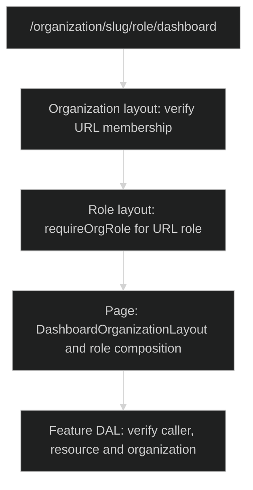
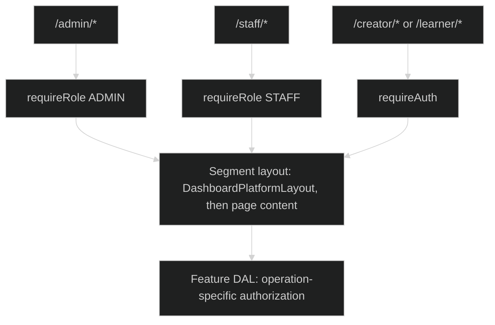

# Dashboard Feature

The dashboard composes product features across platform and organization scopes. This guide is the canonical reference
for dashboard role paths, shells, and routing behavior.

`platform/` holds learner, creator, admin, and staff compositions. `organization/` holds tenant role compositions.
`shared/` contains dashboard shells, UI, data, utilities, and views reused across scopes. This existing composition
grouping is the dashboard exception in
[Feature Architecture](../../_docs/01_FEATURE_ARCHITECTURE.md#standardized-directory-names).

Dashboard is a composition layer. Domain reads and mutations live in feature-owned `server/` modules; profile/admin
operations belong to auth, enrollment/progress to course, and earnings/receipts to payment. Pass URL organization slugs
through shells and views. Layout checks do not substitute for DAL authorization.

Announcement routes (the learner feed, organization-wide authoring and course authoring) compose
[Blog](../../blog/_docs/00_BLOG_FEATURE.md); their sidebar entries come from `lib/config/data.ts`.

## Audience

Engineers changing dashboard composition, navigation, or role-specific routes.

## Why We Structured It This Way

Product domains own their operations; dashboard owns their presentation and composition. Scope and role groups keep
marketplace, organization, and platform administration surfaces separate without copying dynamic URL segments into
feature folders.

The organization feature owns organization creation, selection, membership, and settings. Dashboard supplies shared
compositions and account security UI from auth where needed. Owner and manager routes reuse creator/instructor
compositions where appropriate.

This adds a scope/role choice when placing dashboard UI, but keeps route restructuring separate from domain ownership.
Use [Feature Architecture](../../_docs/01_FEATURE_ARCHITECTURE.md) for the canonical folder vocabulary and dependency
rules.

## Role Matrix and Layout Mappings

Feature paths below are relative to `features/`. The shell's display role controls navigation; server guards and DAL
operations decide access.

| Scope  | Role       | Layout Component              | Sidebar Config                                  | Presentation Directory                         |
| ------ | ---------- | ----------------------------- | ----------------------------------------------- | ---------------------------------------------- |
| B2B    | Learner    | `DashboardOrganizationLayout` | `organizationDashboardData(slug, 'learner')`    | `dashboard/organization/learner`               |
| B2B    | Instructor | `DashboardOrganizationLayout` | `organizationDashboardData(slug, 'instructor')` | `dashboard/organization/instructor`            |
| B2B    | Creator    | `DashboardOrganizationLayout` | `organizationDashboardData(slug, 'creator')`    | `dashboard/organization/creator`               |
| B2B    | Manager    | `DashboardOrganizationLayout` | `organizationDashboardData(slug, 'manager')`    | Reuses `organization/creator` and `instructor` |
| B2B    | Owner      | `DashboardOrganizationLayout` | `organizationDashboardData(slug, 'owner')`      | Reuses `organization/creator` and `instructor` |
| B2C    | Learner    | `DashboardPlatformLayout`     | `platformDashboardData('learner')`              | `dashboard/platform/learner`                   |
| B2C    | Creator    | `DashboardPlatformLayout`     | `platformDashboardData('creator')`              | `dashboard/platform/creator`                   |
| Global | Admin      | `DashboardPlatformLayout`     | `platformDashboardData('admin')`                | `dashboard/platform/admin`                     |
| Global | Staff      | `DashboardPlatformLayout`     | `platformDashboardData('staff')`                | `dashboard/platform/staff`                     |

### Scope Notes

- **Organization Instructor:** `organization/instructor/learners/learners-page.tsx` currently renders placeholder text
  rather than a live learner list.
- **Organization Manager & Owner:** Both roles have no separate presentation folders and reuse `organization/creator`
  and `organization/instructor` views.
- **Platform Admin & Staff:** `platform/admin` composes `auth/` user management and `analytics/` fingerprint reporting;
  `platform/staff` cards currently use static sample values rather than live reporting or moderation operations.
- **Platform Creator & Learner:** `platform/creator` composes `course/` authoring/publishing and `payment/` creator
  payouts; `platform/learner` composes the personal dashboard, public course catalog, certificates, and subscriptions.

`platformDashboardData(role)` supplies marketplace and platform administration navigation.
`organizationDashboardData(slug, role)` requires an organization slug and supplies tenant navigation. Both reuse private
presentation helpers; scope is explicit at each call site.

Navigation labels and destinations come from [sidebar data](../../../lib/config/data.ts). Some entries use placeholder
`#` URLs; a visible entry does not prove a complete feature or grant access. The
[organization shell](../shared/shell/dashboard-organization-layout.tsx) derives its display role from an explicit `role`
prop or the current URL. The [platform shell](../shared/shell/dashboard-platform-layout.tsx) receives its display role
from composition.

## Shared Dashboard Groups

`shared/shell/` contains layouts and sidebars; `shared/ui/` contains presentation helpers; `shared/views/` contains
compositions reused across scopes, such as members and settings views. `shared/data/` and `shared/utils/` hold
dashboard-specific data and utilities.

These established groups are the dashboard composition exception in
[Feature Architecture](../../_docs/01_FEATURE_ARCHITECTURE.md#standardized-directory-names). Domain UI and private
operations remain owned by their product features.

## Dashboard Page Spacing

Use the dashboard shell for the page's scope. The platform and organization shells and the generic loading state share
the same page gutters and section gaps. The underlying Kurume layout sets the inset below the header. The course editor
is the reference for how a standard dashboard page aligns with that header.
[Page spacing](../shared/ui/dashboard-page-shell.tsx) · [Loading shell](../shared/shell/dashboard-shell-skeleton.tsx)

Keep route views aligned with the shell's content edge. Views own padding inside cards, tables, and forms, and layout
within a section. Use `DashboardPageShell` for the common heading, actions, and body layout. Render loading and loaded
content in the same shell and match their section spacing. Specialized layouts such as the lesson player define their
own frame.

When changing a shell or introducing a role view, compare the heading and first content section against a representative
route in each scope in Chromium. Use narrow and wide viewports with comparable sidebar states, and check both the
loading and loaded views for shifts in alignment. See the
[browser testing guide](../../../../../../docs/project/08_TESTING.md).

## Core Routing Architecture

### Tenant Scope: `/organization/[slug]/<role>/dashboard`

The organization layout validates URL membership. Each role segment applies `requireOrgRole` for its minimum role; the
current hierarchy is owner, manager, creator, instructor, learner. Pages compose `DashboardOrganizationLayout` and
feature views. Each DAL operation independently checks its caller, organization, and resource.

See the [organization layout](<../../../app/(dashboard)/organization/[slug]/layout.tsx>),
[manager role layout](<../../../app/(dashboard)/organization/[slug]/manager/layout.tsx>), and
[organization context](../../../server/auth/organization-context.ts).

### Platform Scope: `/admin`, `/staff`, `/creator`, `/learner`

Admin and staff layouts apply their platform role guards. Creator and learner layouts require authentication; individual
DAL operations enforce their own domain permissions. Each dashboard segment (`admin/dashboard`, `staff/dashboard`,
`creator/dashboard`, and the `(shell)` group under `learner/dashboard`) has a `layout.tsx` that composes
`DashboardPlatformLayout` with its display role, so the sidebar and header stay mounted between pages. Pages render only
their content. The `(shell)` group keeps the full-screen `learn/` routes outside the shell.

See the [admin layout](<../../../app/(dashboard)/admin/layout.tsx>) and
[learner layout](<../../../app/(dashboard)/learner/layout.tsx>).

## Failure Modes and Edge Cases

- **Missing session, foreign organization, or insufficient role:** `requireOrgRole` redirects unauthenticated callers to
  sign-in, renders not-found for missing organizations/non-members, and redirects insufficient roles to its configured
  fallback. HTTP adapters map access failures to status codes. Unexpected database errors propagate to the relevant
  error boundary; Suspense handles pending rendering.
- **Display role differs from membership:** The shell's `role` prop controls presentation. It cannot override verified
  membership or resource checks. Use a supported role URL only when its guards and DAL allow the operation.
- **Two organization tabs:** Each operation uses its URL slug. Layouts do not change `session.activeOrganizationId`;
  explicit selection/switching updates that navigation preference.

## DAL Ownership

Dashboard owns composition and presentation. Course, quiz, blog, auth, payment, organization, analytics, and media own
their server data access. Pass URL organization slugs through composition; layout checks do not replace DAL
authorization.

## Related Guides

- [Repository Architecture](../../../../../../docs/project/04_ARCHITECTURE.md)
- [Web Overview](../../../../_docs/00_WEB.md)
- [Feature Architecture](../../_docs/01_FEATURE_ARCHITECTURE.md)
- [Server Data Access](../../_docs/03_SERVER_DATA_ACCESS.md)
- [Agent Feature Workflow](../../_docs/04_AGENT_FEATURE_WORKFLOW.md)
